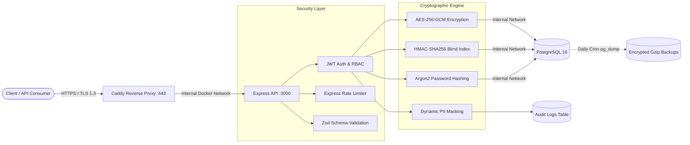

# PII Secure App — Enterprise-Grade Privacy & Data Protection Service

A production-ready Node.js & TypeScript backend service engineered to store, search, and audit Personally Identifiable Information (PII) under zero-trust security principles.

---

## System Architecture & Cryptographic Data Flow



---

## Core Security Architecture

| Security Domain | Implementation Details | Threat Mitigated |
| :--- | :--- | :--- |
| **Encryption at Rest** | **AES-256-GCM** with unique random IVs and authentication tags per field (phone, email). | Database dumps or disk theft reveal zero plaintext PII. |
| **Searchable Encryption** | **HMAC-SHA256 Blind Indexing** using a dedicated server-side salt. | Enables O(1) indexed exact-match queries without decrypting rows. |
| **Credential Storage** | **Argon2** memory-hard password hashing. | Protects user credentials against GPU/ASIC brute-force attacks. |
| **RBAC & Dynamic Masking** | Middleware-enforced role evaluation (ADMIN vs MEMBER). MEMBER receives masked PII; ADMIN receives decrypted values. | Prevents horizontal privilege escalation and over-exposure of sensitive fields. |
| **Compliance Auditing** | Asynchronous immutable logging to audit_logs on every USER_LOGIN and PII_READ event. | Full traceability of who accessed whose plaintext PII and when. |
| **Network Hardening** | Caddy automatic Let's Encrypt HTTPS (sslip.io), public DNS resolution, and zero host port bindings for PostgreSQL (5432) and Express (3000). | Eliminates MITM sniffing and direct external database/app attack surfaces. |

---

## DevSecOps & Production Operations

- **Multi-Stage Docker Build**: Compiles TypeScript in an isolated builder stage and runs production workloads under a non-root node user.
- **Automated Idempotent Migrations**: Container startup sequence (npm run start:prod) automatically runs transactional schema migrations before accepting traffic.
- **CI/CD Quality & Security Gates (GitHub Actions)**:
  1. **Integration Testing**: Spins up a live PostgreSQL 16 service container and enforces Jest code coverage thresholds.
  2. **Dependency & Container Scanning**: Runs npm audit and **Trivy** (CRITICAL, HIGH severity checks) before pushing images to GHCR.
  3. **Automated Deployment**: Zero-downtime container recreation on AWS EC2 via SSH.
- **Automated Disaster Recovery**: Daily 03:00 Cron job executing pg_dump | gzip with a 7-day rolling retention policy.

---

## API Reference

| Method | Endpoint | Auth / Role | Description |
| :--- | :--- | :--- | :--- |
| GET | / | Public | Service health check |
| POST | /api/v1/users | Public (Rate-Limited) | Register user with encrypted PII and Argon2 password hash |
| POST | /api/v1/auth/login | Public (Rate-Limited) | Authenticate via blind-indexed phone + password; issues 24h JWT |
| GET | /api/v1/users/me | Bearer JWT | Retrieve current user profile (masked for MEMBER, plaintext for ADMIN) |
| GET | /api/v1/users/search?phone=... | Bearer JWT | Exact-match search via HMAC blind index + RBAC output masking |
| GET | /api/v1/audit-logs?limit=20&offset=0 | Bearer JWT (ADMIN) | Paginated compliance audit trail (403 Forbidden for MEMBER) |

---

## Local Development & Testing

```bash
# 1. Install dependencies
npm ci

# 2. Configure environment variables (.env)
# Required: DATABASE_URL, PII_ENCRYPTION_KEY (64-char hex), PII_BLIND_INDEX_SALT, JWT_SECRET

# 3. Run full integration test suite with coverage report
npm test

# 4. Build and start production bundle
npm run build && npm run start:prod
```
